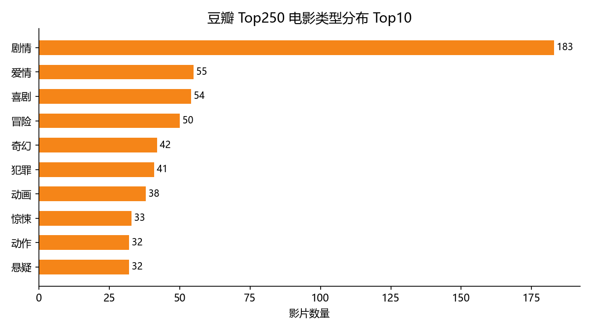
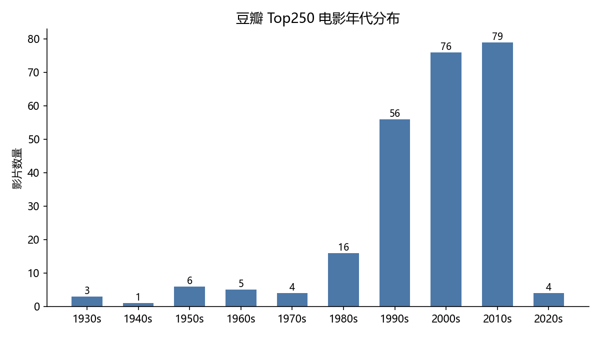
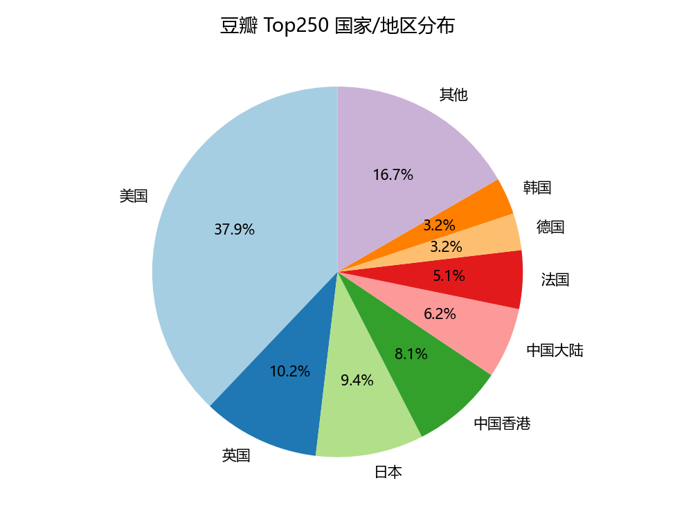
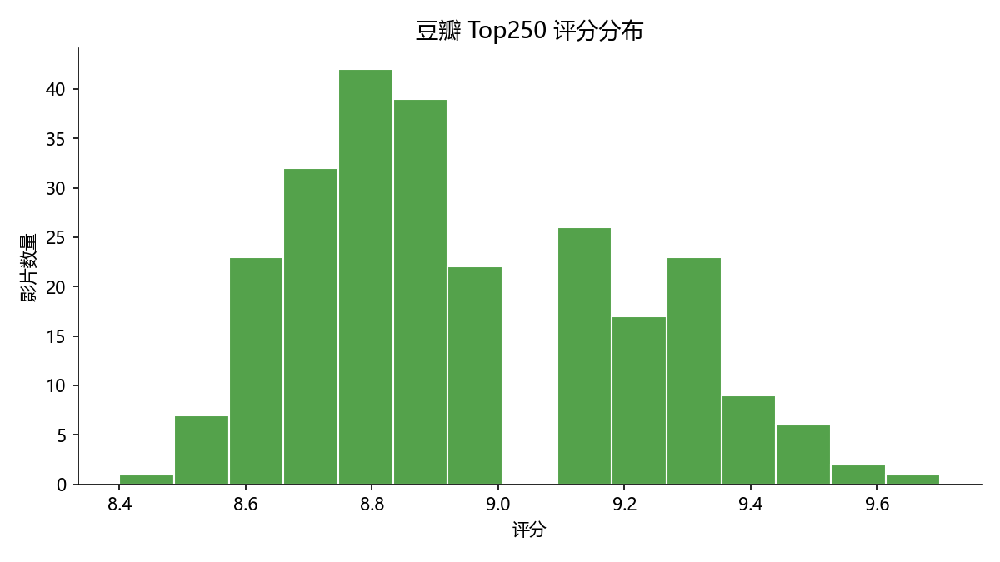

# 豆瓣电影 Top250 数据抓取与分析

用 Python 爬取豆瓣电影 Top250 榜单，完成数据清洗、统计分析与可视化，共 250 条结构化数据。

**主要结论：1990 年后的作品占 86.0%，剧情类占 73.2%，美国片占 56.4%，平均评分 8.94。**

**技术栈**：Python · requests · BeautifulSoup · Pandas · Matplotlib

---

## 主要发现

### 1. 榜单高度偏向近三十年的作品

| 时间范围 | 影片数 | 占比 |
|---|---|---|
| 1990 年及以后 | 215 | 86.0% |
| 2000 年及以后 | 159 | 63.6% |
| 1980 年以前 | 19 | 7.6% |

年份中位数 **2004 年**，最早 1931 年，最新 2023 年。2010s（79 部）、2000s（76 部）、1990s（56 部）三个十年合计占 84.4%。

### 2. 剧情片是绝对主流

剧情类 **183 部，占 73.2%**，其后依次为爱情 55、喜剧 54、冒险 50、奇幻 42。榜单的类型集中度很高，反映的是大众审美而非类型多样性。

### 3. 美国电影占主导，亚洲影片占比不低

美国 **141 部，占 56.4%**，其后为英国 38、日本 35、中国香港 30、中国大陆 23、法国 19。前三大产地合计占 85.6%。

### 其他指标

- 平均评分 **8.94**，区间 8.4 – 9.7，评分 ≥ 9.5 的有 9 部
- 评价人数中位数 **74.8 万**；最高为《肖申克的救赎》335 万

---

## 可视化结果

### 类型分布 Top10



### 年代分布



### 国家 / 地区分布



### 评分分布



---

## 数据集说明

`douban_raw.csv` / `douban_clean.csv`，共 250 条记录：

| 字段 | 说明 | 示例 |
|---|---|---|
| 排名 | 榜单名次（1–250） | 1 |
| 片名 | 电影中文名 | 肖申克的救赎 |
| 评分 | 豆瓣评分 | 9.7 |
| 评价人数 | 参与评分的人数 | 3352992 |
| 年份 | 上映年份 | 1994 |
| 国家 | 制片国家/地区，可能多值 | 美国 |
| 类型 | 影片类型，可能多值 | 犯罪 剧情 |
| 年代 | 由年份派生的十年段（仅清洗后数据） | 1990s |

---

## 项目结构

```
.
├── get_data.py          # 爬虫：抓取榜单并解析字段
├── analyze.py           # 清洗与统计：输出 4 个统计 CSV
├── plot.py              # 可视化：输出 4 张图表
├── diag_star.py         # 诊断脚本：用于排查解析失败问题
├── 分析报告.md           # 数据分析报告
├── 操作指南.md           # 环境配置与操作步骤说明
├── douban_raw.csv       # 原始数据（250 条）
├── douban_clean.csv     # 清洗后的数据
├── decade_count.csv     # 年代统计结果
├── country_count.csv    # 国家统计结果
├── genre_count.csv      # 类型统计结果
└── chart_*.png          # 4 张可视化图表
```

## 快速开始

```bash
pip install -r requirements.txt

python get_data.py     # 抓取 10 页，得到 douban_raw.csv（约 40 秒）
python analyze.py      # 清洗 + 统计，输出 4 个 CSV
python plot.py         # 生成 4 张图表
```

> Windows 用户如果 `python` 命令不可用，改用 `py`。

## 数据处理流程

1. **抓取**：遍历 10 个分页（每页 25 部），每次请求间隔 3 秒，使用自定义 User-Agent 避免被拒绝
2. **字段解析**：用 CSS 选择器提取排名、片名、评分；用正则从文本中提取评价人数、年份、国家与类型
3. **清洗**：
   - 评分、评价人数、年份由文本转为数值类型，无法转换的记录剔除
   - 按片名去重
   - 「国家」「类型」字段存在多值（如"英国 美国"、"犯罪 剧情"），拆分为多个值后逐个统计
   - 由年份派生「年代」字段
4. **统计**：按年代、国家、类型分组计数
5. **可视化**：柱状图、横向条形图、饼图、直方图

## 遇到的问题与解决

**问题一：评价人数整列为空**

首次抓取后，250 条记录的评价人数全部缺失。编写诊断脚本（`diag_star.py`）打印页面中所有 `<span>` 节点的文本，发现豆瓣改版后原有的 `div.star` 元素已不存在，评价人数被移入一个没有 class 属性的 span 中，导致 CSS 选择器定位失败。

解决方案：不再依赖选择器定位，改为在条目的整段文本中用正则匹配 `数字 + 人评价` 的模式，修复后 250 条全部提取成功。

**问题二：国家字段多值导致统计失真**

初次统计出现「英国 美国 12」这类无意义结果，原因是合拍片的国家字段包含多个值，被当作单一值计数。

解决方案：参照类型字段的处理方式，按空格拆分后逐个国家计数，修正后美国由 80 部修正为 141 部。

**问题三：请求频率控制**

为避免对目标服务器造成压力以及触发反爬限制，在分页请求之间设置 3 秒间隔，并对单页失败的情况做跳过处理，保证脚本可以重复运行补齐数据。

## 局限与改进方向

1. 样本仅 250 部，且由用户投票产生，存在选择偏差，不能代表全部电影
2. 榜单为静态快照，会随时间变化
3. 「国家」「类型」来自网页文本，存在少量标注不一致
4. 爬虫依赖网页结构，网站改版会导致解析失效；生产环境中更稳妥的方式是使用官方 API 或结构化数据源
5. 可扩展方向：抓取更多榜单并做时间序列对比、对影片简介做文本分词与关键词提取

---

详细分析见 [分析报告.md](分析报告.md)。
